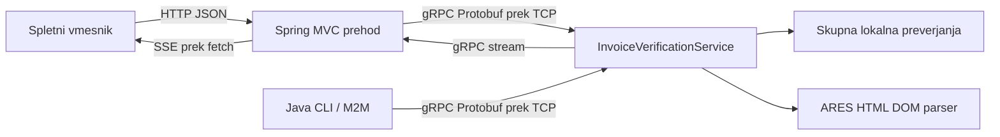

# Naloga 5 - gRPC preverjanje računa

IVAS ima eno gRPC storitev s štirimi RPC metodami. Spletna aplikacija omogoča
lokalni pregled vnesenih podatkov računa, izrecno pridobivanje češkega dobavitelja
iz ARES ter postopno preverjanje s sprotnim prikazom rezultatov.

Implementacija nadgrajuje glavni Java/Spring Boot projekt. Obstoječi lokalni
izračuni naloge 4 so izločeni v skupno storitev; AI obrazec ohranja svojo pogodbo
in zahtevo po izrecnem soglasju. Statistika SURS, parser ARES in ločeni LabTrack
ostajajo na voljo. Novi tok ne kliče Azure in deluje brez njegove konfiguracije.

## Zahteve naloge

| Zahteva | Izvedba |
|---|---|
| 1 service | `ivas.v1.InvoiceVerificationService` |
| Vsaj 4 RPC | `GetCapabilities`, `ValidateInvoice`, `LookupSupplier`, `VerifyInvoice` |
| Vsaj 1 streaming RPC | `VerifyInvoice` vrne `stream VerificationEvent` |
| Podatkovni message | `Invoice`, `InvoiceLine`, `Supplier`, `CheckResult`, poročilo in drugi |
| Message za zahtevke in odgovore | Vsak unary RPC ima lastna request/response sporočila; streaming ima request in tip dogodka |
| Pridobitev na uporabnikovo zahtevo | Gumbi za lokalni pregled, ARES in celoten pregled |
| Sprotna obdelava in prikaz | Lokalne vsote prispejo pred zaključkom počasnejšega registrskega preverjanja |
| Delujoč gRPC odjemalec | Spletni prehod in samostojni Java CLI uporabljata generirane nastavke prek TCP |

## Zagon

Potrebujete JDK 25 in Maven Wrapper. Prva gradnja potrebuje internet za Maven
odvisnosti in prevajalnika Protobuf/gRPC. Njune različice sledijo obstoječemu
Spring Boot BOM: gRPC Java 1.83.1 in Protobuf 4.35.1.

V korenu projekta:

```powershell
.\mvnw.cmd spring-boot:run
```

Odprite **http://localhost:8080/invoice-verification.html**.
Povezava je tudi na statistični strani in obstoječem AI obrazcu.

Če uporabljate že pripravljene lokalne razvojne odvisnosti tega repozitorija:

```powershell
$env:JAVA_HOME = (Resolve-Path '.local/jdk-25').Path
$env:MAVEN_USER_HOME = (Resolve-Path '.local/maven').Path
.\mvnw.cmd '-Dmaven.repo.local=.local/repository' spring-boot:run
```

Za lokalni izračun in pregled brez ARES ne potrebujete brskalniškega driverja.
ARES uporablja obstoječi Playwright parser. Privzeto uporabi njegov Chromium.
Če želite uporabiti nameščeni Microsoft Edge:

```powershell
$env:IVAS_ARES_BROWSER_CHANNEL = 'msedge'
```

To nastavite pred zagonom aplikacije. Dovoljeni vrednosti sta `msedge` in
`chrome`; prazna vrednost pomeni privzeti Playwright Chromium. Obstoječe zahteve
parserja in namestitev brskalnika so opisane tudi v `Naloga2_Spletni_Parser.md`.

| Nastavitev | Pomen |
|---|---|
| `IVAS_GRPC_PORT` | Privzeto `50051`; strežnik je vezan samo na `127.0.0.1` |
| `IVAS_ARES_BROWSER_CHANNEL` | Izbira že nameščenega brskalnika za parser |
| `ivas.cli.port` | Java/Maven sistemska lastnost za vrata CLI; privzeto `50051` |

Spletni prehod vedno uporabi dejanska vrata lokalnega gRPC strežnika.
V avtomatskih testih so nastavljena naključna prosta vrata (`ivas.grpc.port=0`),
zato različni testni Spring konteksti ne tekmujejo za vrata 50051.

`.env.example` je samo seznam nastavitev; Spring ne bere `.env` samodejno.

## Arhitektura in komunikacijska pot



Brskalnik ne govori neposredno protokola gRPC. Spletni prehod je pravi gRPC
odjemalec: uporablja generirani stub in lokalni TCP kanal do ločenih gRPC vrat.
Ne kliče implementacijskih metod neposredno. Protobuf tako dejansko sodeluje
pri prenosu podatkov; rezultat za brskalnik se na meji pretvori v JSON/SSE.

HTTP in gRPC tečeta v istem Spring Boot procesu; nova mikroservisna namestitev
ali Envoy za to izvedbo nista potrebna. CLI demonstrira neposredno M2M povezavo.
Ni avtomatskih ponovitev. Lokalni kanal uporablja plaintext in ni namenjen
javni produkcijski izpostavitvi.

## RPC pogodba

Definicija: `src/main/proto/ivas/v1/invoice_verification.proto`.
Maven med gradnjo ustvari Java sporočila in strežniški/odjemalčev nastavek v
`target/generated-sources/protobuf/`. Generirane datoteke niso v Gitu.

| RPC | Vhod | Izhod / pomen |
|---|---|---|
| `GetCapabilities` | Prazen namenski request | Preverjanja, podprte države registrov, omejitve in obseg |
| `ValidateInvoice` | `Invoice` | Lokalne vsote, datumi in posamezni statusi |
| `LookupSupplier` | `Supplier` | Registrski zapis, vir, čas in status pridobivanja |
| `VerifyInvoice` | `Invoice` in `check_registry` | Tok začetka, lokalnega rezultata, registrskega dela in končnega poročila |

Vsak tok ima lasten UUID, zaporedne številke od 1 in čas dogodka. `oneof`
opredeli vrsto vsebine dogodka. Ob vključenem registru je običajen vrstni red:

1. `started`
2. `local`
3. `registry_started`
4. `supplier`
5. `report`, nato normalni zaključek gRPC toka

Brez registra so dogodki `started`, `local`, `report`. Rezultati se pošiljajo ob
dejanskem napredku, brez umetnih zamikov. Posamezni poslovni koraki uporabljajo
iste storitve kot unary RPC; strežnik ne kliče lastnih RPC metod prek omrežja.

### Podatki in preverjanja

- Zneski in količine v Protobuf so decimalni nizi. Strežnik uporablja
  `BigDecimal`, tudi AI pot po izločitvi skupne kode.
- Neto postavka = količina x neto cena; vsaka postavka se zaokroži `HALF_UP` na
  najmanjšo enoto valute. Vsota se primerja z navedenim netom.
- Bruto = navedeni neto + navedeni davek. Pravilnost davčne stopnje se ne sklepa.
- Datum zapadlosti ne sme biti pred datumom izdaje; odsoten datum je `UNKNOWN`.
- Omejitve ostajajo skladne z obstoječim obrazcem: 1-30 postavk, pozitivna
  količina, nenegativni zneski, meje velikosti/natančnosti in dolžin besedil.
- Datumi uporabljajo ISO `yyyy-MM-dd`. Neobvezni datumi in identifikatorji
  uporabljajo prisotnost polja (`optional`), ne nadomestnih ničelnih vrednosti.
- IČO ostaja niz z natanko osmimi ASCII števkami, vključno z začetnimi ničlami.
  Ne sklepa se iz DDV številke ali naziva.
- Pri primerjavi z ARES je IČO strog; naziv se primerja po normalizaciji
  presledkov in velikosti črk (`Locale.ROOT`), brez približnega iskanja.
- `PARTIAL` ostane izrecno viden. Brez IČO ali naziva ni mogoče potrditi ujemanja.
- Viri so označeni `LOCAL`, `ARES_WEB / HTML_DOM`, `VIES` ali `NOT_IMPLEMENTED`.

Številke Protobuf polj so del pogodbe: pri odstranitvi se številka in ime
rezervirata, pri razširitvi se uporabijo nove številke. Enum ničelne vrednosti
so `UNSPECIFIED`; niso uspeh preverjanja.

### Ocena računa

- Dejansko neskladje ima prednost in pomeni `REVIEW_REQUIRED`.
- Brez zaznanega neskladja je trenutni skupni rezultat
  `INCOMPLETE_VERIFICATION`: VIES in davčna skladnost še nista preverjena.
- `NO_ISSUES_DETECTED` je predviden v pogodbi za prihodnjo razširitev. Trenutna
  izvedba ga ne vrača kot lažno potrdilo o celoviti validaciji.
- Neizbrani register, nepodprta država ali nedosegljivi vir imajo razložen
  `UNKNOWN`. Tehnična napaka ARES ni dokaz neobstoja dobavitelja.
- Poročilo vsebuje tudi obseg, ugotovitve in priporočilo. Ne odobrava plačila.

## Spletni API

| Pot | Metoda | Vsebina |
|---|---|---|
| `/api/v1/verification/capabilities` | GET | Zmožnosti prek unary RPC |
| `/api/v1/verification/local` | POST | `{ "invoice": { ... } }` |
| `/api/v1/verification/supplier` | POST | `{ "name": "...", "country": "CZ", "registryId": "00006947" }` |
| `/api/v1/verification/stream` | POST | `{ "invoice": { ... }, "checkRegistry": true }` |

Vhodni JSON računa je v `docs/examples/invoice-grpc.json`. V spletnem zahtevku
ga obdajte s poljem `invoice`; CLI prebere neposredno vsebino te datoteke.
Spletni obrazec zneske pošilja kot decimalne nize.

Unary odgovori in dogodki sledijo Protobuf JSON zapisu (camelCase polja,
imenske enum vrednosti, ISO čas). Privzete vrednosti so lahko izpuščene.
Odgovori uporabljajo `Cache-Control: no-store`.

Stream uporablja `text/event-stream` z dogodki `verification` in morebitnim
terminalnim `failure`. HTTP 200 pomeni odprt tok, ne nujno uspešno preverjanje.
Šele dogodek `report` in pravilen zaključek pomenita končni rezultat. Vmesnik
preverja zaporedne številke in ID zahtevka; ob nepopolnem toku ne ponuja
delnega rezultata kot končnega JSON poročila.

Vsako sekundo se lahko pošlje SSE komentar `keepalive`, ki omogoča zaznavanje
odklopljenega brskalnika tudi med čakanjem na ARES. Komentar ni poslovni rezultat
in ne spreminja zaporednih številk. Gumb za preklic prekine `fetch`; odklop se
posreduje v gRPC. Parser sodelovalno preverja preklic med koraki in DOM pollingom.
Že začeta navigacija Playwright se lahko zaključi šele ob svoji časovni omejitvi
(do 30 sekund); preklic ni obljuba takojšnje prekinitve zunanjega strežnika.

gRPC odjemalci imajo največ 65 sekund za registrski/celotni pregled, lokalni
spletni klici pa 5 sekund. Spletni emitter ima omejitev 70 sekund. Največ osem
aktivnih RPC operacij in največ dva brskalnika ARES na instanco preprečujeta
neomejeno vzporedno zaganjanje. Protobuf zahtevek in novi spletni JSON zahtevki
so omejeni na 128 KiB, tudi brez `Content-Length`.

| Napaka | gRPC | Spletni unary status |
|---|---|---|
| Neveljaven vhod | `INVALID_ARGUMENT` | 400 |
| Prevelik spletni zahtevek | - | 413 |
| Zasedena mesta | `RESOURCE_EXHAUSTED` | 429 |
| Potek časa | `DEADLINE_EXCEEDED` | 504 |
| Storitev nedosegljiva | `UNAVAILABLE` | 503 |
| Preklic | `CANCELLED` | 409 |
| Nepričakovana napaka | `INTERNAL` | 502 |

Neskladje vsot je normalen rezultat `FAIL`, ne transportna napaka.
Nedosegljivi ARES vrne `SOURCE_ERROR` v podatkovnem rezultatu, ohrani lokalna
preverjanja in ne postane `NOT_FOUND`. Sledi sklada in surovi tehnični odgovori
niso del odgovorov uporabniku.

## Neposredni Java odjemalec

Najprej v ločenem terminalu zaženite IVAS. Nato v korenu projekta:

```powershell
.\mvnw.cmd compile exec:java '-Dexec.mainClass=um.feri.ipt.tids.project.grpc.VerificationCli' '-Dexec.args=capabilities'
.\mvnw.cmd exec:java '-Dexec.mainClass=um.feri.ipt.tids.project.grpc.VerificationCli' '-Dexec.args=validate docs/examples/invoice-grpc.json'
.\mvnw.cmd exec:java '-Dexec.mainClass=um.feri.ipt.tids.project.grpc.VerificationCli' '-Dexec.args=verify docs/examples/invoice-grpc.json'
```

Za uporabo lokalnega Maven predpomnilnika dodajte
`'-Dmaven.repo.local=.local/repository'` in nastavite JDK/Maven okolje kot zgoraj.
`exec-maven-plugin` se mora ob prvi uporabi prenesti z interneta.

Samostojna pridobitev javnega češkega zapisa, ki **sproži pravi klic ARES**:

```powershell
.\mvnw.cmd exec:java '-Dexec.mainClass=um.feri.ipt.tids.project.grpc.VerificationCli' '-Dexec.args=supplier 00006947'
```

Za celotni pregled z ARES nastavite v kopiji vhodnega računa državo `CZ`, IČO in
ustrezen naziv, nato uporabite `verify <datoteka.json> --ares`. Sintetičnega
dobavitelja ne predstavljajte kot dejansko podjetje. Dodatna lastnost
`'-Divas.cli.port=50061'` omogoča drug lokalni gRPC port.

CLI izpiše Protobuf JSON; pri streamingu vsako sporočilo v svojo vrstico.
Povezuje se neposredno na `127.0.0.1`, brez spletnega prehoda ali AI klica.

## Demonstracija v brskalniku

1. Odprite stran in kliknite **Vstavi sintetični primer**. To ne kliče ARES.
2. Izberite **Preveri samo lokalno**. Neto je 250.00, bruto 305.00; manjkajoča
   preverjanja so izrecno ločena od lokalnih izračunov.
3. Spremenite bruto v 300.00. Stari rezultat se skrije. Zaženite preverjanje;
   končna ocena mora biti **Potreben je pregled**.
4. Za ARES vnesite CZ in javni IČO ter ustrezen naziv. Gumb za dobavitelja
   izvede samostojen RPC. Za vključitev v tok označite ARES in začnite pregled.
5. Opazujte lokalne rezultate, nato registrske podatke in poročilo. Dejansko
   hitri odzivi ARES lahko pomenijo majhen časovni razmik; ni umetnih zakasnitev.
6. Poskusite drugo ime dobavitelja ter nedosegljivost vira. Neskladje in
   nedokončano preverjanje imata različno razlago.
7. Med čakanjem kliknite **Prekini preverjanje**. Delni rezultati ostanejo
   označeni kot nedokončni; nove zahteve lahko ponovno sprožite.
8. Oglejte si in prenesite JSON končnega rezultata. Vsebina se prikazuje kot
   besedilo, ne kot HTML, ter se ne shranjuje v `localStorage` ali bazo.

## Testi

Običajni testi ne kličejo zunanjega ARES/SURS ali Azure:

```powershell
.\mvnw.cmd test
.\mvnw.cmd package
```

Vsi lokalni brskalniški in regresijski testi z obstoječim Edge:

```powershell
$env:PLAYWRIGHT_SKIP_BROWSER_DOWNLOAD = '1'
.\mvnw.cmd '-Dmaven.repo.local=.local/repository' --offline '-Dverification.browser.tests=true' '-Dadvice.browser.tests=true' '-Dstatistics.browser.tests=true' '-Dares.browser.tests=true' '-Dares.browser.channel=msedge' '-Dlogging.level.root=ERROR' '-Dspring.main.banner-mode=off' package
```

`--offline` je primeren šele po prenosu vseh potrebnih odvisnosti in vtičnikov.
Brskalniški testi ARES uporabljajo lokalne DOM primere, novi gRPC testi pa
lokalni registrski nadomestek. Zunanja živa preverjanja ostajajo ločena.

Testi preverjajo pravo TCP povezavo z generiranimi nastavki, štiri metode,
omejitve in neveljavne vhode, decimalne izračune, prisotnost neobveznih polj,
preslikave ARES, razliko med neobstojem in napako vira, zaporedje dogodkov,
prihod lokalnih rezultatov pred zaključkom blokiranega registra, preklic,
časovno omejitev, HTTP/SSE pogodbo, varen prikaz besedila in mobilni prikaz.

Brskalniški posnetki so v ignorirani `target/verification-preview/`.
Niso dokaz odgovora pravega zunanjega registra.

## Meje izvedbe

Ta naloga namenoma implementira preverjanje strukturiranega uporabniškega
vnosa; uvoz UBL 2.1 XML, popolna shematska validacija, VIES, francoski register,
dobropisi, dokumentni popusti/stroški in davčna pravila ostajajo prihodnje delo.
Podatkovni model omogoča dodajanje UBL prilagodilnika pred istimi preverjanji.

ARES uporablja obstoječi HTML parser, ne uradnega REST API. Njegovo delovanje
je odvisno od zunanjega DOM in razpoložljivega brskalnika. gRPC zmanjša potrebo
po čakanju na celotno poročilo, ne odstrani časa zunanjega registra. Primerjalna
meritev hitrosti glede na REST ni bila izvedena.

## Uradni tehnični viri

- [gRPC Java: osnove in generirani nastavki](https://grpc.io/docs/languages/java/basics/)
- [gRPC Java implementacija in Maven odvisnosti](https://github.com/grpc/grpc-java)
- [Časovne omejitve](https://grpc.io/docs/guides/deadlines/)
- [Preklic](https://grpc.io/docs/guides/cancellation/)
- [Protobuf proto3 in prisotnost polj](https://protobuf.dev/programming-guides/proto3/)
- [gRPC-Web in brskalniški posrednik](https://grpc.io/docs/platforms/web/quickstart/)


## Rezultati preverjanja - 10. 11. 2026

- Gradnja `package` z vsemi zgoraj navedenimi lokalnimi brskalniškimi zastavicami:
  **BUILD SUCCESS**, 58 testov, 55 izvedenih uspešno, 3 namerno preskočeni
  (dva opt-in živa ARES testa in en opt-in živi SURS test), brez napak.
- Vseh 16 novih testov naloge 5 je uspešnih. Izvedeni so tudi regresijski testi
  obstoječih lokalnih izračunov, AI pogodbe, statistike in ARES DOM parserja.
- Edge preverjanje pri 1440 in 390 px: sprotni rezultati pred registrom,
  sprememba podatkov, preklic in ponovni zagon, varen prikaz nepreverjenega
  besedila ter odsotnost vodoravnega prelivanja; posnetki vizualno pregledani.
- JavaScript je preverjen z `node --check`.
- Zapakirani izvršljivi JAR je dejansko zagnan na ločenih lokalnih vratih
  HTTP 18080 / gRPC 50061. Vsebuje nove razrede, vmesnik in definicijo protokola;
  `Start-Class` ostaja `ProjectApplication`.
- Neposredni Java CLI uspešno izvede `capabilities`, `validate` in
  `verify ... --ares`; zadnji vrne pet zaporednih dogodkov z istim ID in
  končno poročilo. To je preizkus dejanske povezave do JAR, ne klic metod v JVM
  odjemalca ali spletni REST nadomestek.
- Dve ločeni živi poizvedbi prek nove gRPC poti za javni IČO `00006947`
  vrneta `FOUND`, naziv **Ministerstvo financí**. V celotnem CLI pregledu je
  registrsko ujemanje `PASS`; skupna ocena ostane pravilno
  `INCOMPLETE_VERIFICATION` zaradi neizvedenih VIES/davčnih preverjanj.
- Med preverjanjem ni bilo pravih Azure klicev. Začasni demonstracijski
  proces uporablja izrecno izklopljen AI in je po preverjanju ustavljen.

Na JDK 25 ostajata opozorili o dinamičnem Mockito agentu in uporabi
`sun.misc.Unsafe` v knjižnici Protobuf; gradnja in preverjeni tokovi so uspešni.
Opozorilo o prevelikem gRPC sporočilu v testnem logu je pričakovan del testa
omejitve 128 KiB, ne neuspeh testa.
